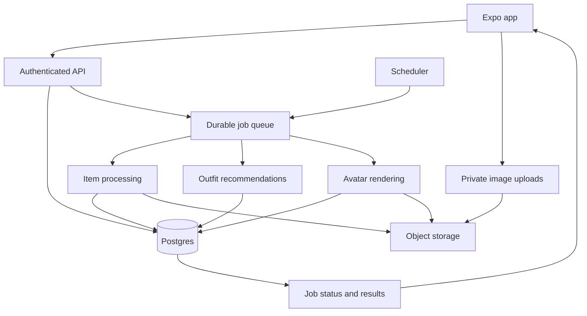

# Wardrobe App Architecture Report

Research checked: September 28, 2026.

**Recommendation: build the app around an accurate wardrobe, a record of what the user actually wears, and a recommendation system that improves from feedback. Treat avatar generation as a separate visualization feature.**

Right now, those responsibilities are mixed together. That makes it easy to produce a nice-looking screen, but difficult to answer basic questions reliably: “Do I own everything in this outfit?”, “Have I worn this before?”, “Why did you recommend it?”, and “Will my outfit survive if image generation fails?”

This report is based on inspection of our item upload flow, item and outfit types, recommendation code, state management, calendar, analytics, and avatar service, plus research into Alta, Whering, Acloset, and Indyx using their own documentation.

This is a proposed architecture, not a claim about competitors’ private systems. No application code was changed for this report.

## 1. What the product should actually do

The core loop should be:

```text
Add clothes
    ↓
Understand and organize them
    ↓
Suggest useful combinations
    ↓
User saves, changes, rejects, or wears them
    ↓
Learn what works
    ↓
Suggest better combinations
```

Avatar previews support that loop.  

There are four distinct outputs:

| Output | What it means | Does it need generative AI? |
|---|---|---|
| Item record | A specific piece the user owns | AI helps identify it; ownership and history are ordinary data |
| Outfit composition | Specific items arranged into a wearable combination | Rules plus AI can help |
| Styling description | Name, explanation, suggested occasions, styling advice | Often useful |
| Avatar preview | A visual approximation of the outfit on a person | Yes, for our intended experience |

An outfit must remain valid if its description is missing or its avatar is still loading.

For the current builder, we can retain **Select → Generate → Preview → Save**. Behind that interface, Generate should create the composition first, enrich the description separately, and request the avatar independently. If rendering fails, the selected pieces and outfit details should remain available.

## 2. What other apps publicly document—and what we cannot know

| App | Documented behavior | Relevant lesson |
|---|---|---|
| **Alta** | Daily recommendations based on wardrobe and weather, avatar previews, trip planning, outfit logging, saved looks | Context, history, and visualization are separate product capabilities. [Alta](https://www.altadaily.com/), [feature overview](https://www.altadaily.com/blog/alta-main-features) |
| **Whering** | Daily suggestions through W Pick; user-controlled combinations through Dress Me; filters, planning, and wear-based statistics | Automatic suggestions and manual exploration should coexist. [Outfit suggestions](https://whering.co.uk/faq/outfit-suggestions-on-Whering), [cost per wear](https://whering.co.uk/faq/cost-per-wear) |
| **Acloset** | Automatic attribute extraction; recommendations based on wardrobe, weather, and occasion; separate virtual try-on | Catalog quality directly affects recommendation usefulness. [Acloset](https://www.acloset.app/), [support](https://www.acloset.app/support/) |
| **Indyx** | Wardrobe cataloging, outfit planning, wear tracking, analytics, and access to human stylists | Useful wardrobe infrastructure does not depend on every decision being made by AI. [Indyx](https://www.myindyx.com/) |

There is also an actual technical account of Alta’s image processing: Meta describes Alta using Segment Anything for garment segmentation, including difficult cases such as jewelry, reflective surfaces, hangers, and low-contrast backgrounds. That documents part of its image pipeline, **not its outfit scheduling or ranking architecture**. [Meta’s Alta case study](https://ai.meta.com/blog/alta-daily-fashion-app-segment-anything/)

**Do they continuously generate outfits in the background?**

The public sources reviewed do not establish that.

“Daily recommendations” could mean:

- A scheduled server job prepares suggestions.
- Opening the app triggers generation.
- The app ranks previously prepared combinations.
- A hybrid of those approaches.

I would use the hybrid approach for us. It gives a fast experience without continuously paying to generate things nobody sees.

## 3. Where our app stands today

The app is currently a functional UI prototype with some live image processing, rather than a durable wardrobe platform.

| Area | What the code currently does | Architectural consequence |
|---|---|---|
| Item storage | Keeps items in React state initialized from mock data | User data does not have durable storage in this provider |
| Saved outfits | Stores them in the same in-memory context | Saved looks need persistence and stable identity |
| Outfit recommendations | Picks items by category and array offset | No real compatibility, weather, availability, or preference ranking |
| Recommendation IDs | Reuses IDs such as `all-look-1` | The same ID can represent different items as the wardrobe changes |
| Item recognition | Extracts color, fit, sleeves, pattern, material, and other attributes | Several extracted attributes are discarded before saving |
| Categories | Five broad categories | Insufficient for dresses, layered shirts, different accessories, or sets |
| Price | Defaults missing prices to zero | “Unknown price” becomes indistinguishable from “free” |
| Wear history | Stores `wearCount` and `lastWorn` directly | No underlying events to verify, correct, or analyze |
| Planning | Uses local state for planned looks | Planning is not a durable calendar or wear log |
| Analytics | Treats zero recorded wears as never worn | Misleading for clothes owned before joining the app |
| Builder preview | Currently uses a timed mock preview and fixed styling text | It is a demo, not real outfit analysis |
| AI access | Reads a Cloudflare token through `EXPO_PUBLIC_*` | Credentials must move behind a server |

Relevant files: [item and outfit models](../data/mock.ts), [wardrobe state](../state/closet-context.tsx), [recommendation engine](../services/outfit-engine.ts), [scan flow](../app/scan.tsx), [analytics](../app/analytics.tsx).

The credential issue is concrete: Expo substitutes `EXPO_PUBLIC_*` values into client code and explicitly warns against storing private credentials there. If a real provider token has been included in a distributed build, treat it as exposed and rotate it when moving calls server-side. [Expo environment-variable documentation](https://docs.expo.dev/guides/environment-variables/)

## 4. What should happen when someone adds an item

The user should mostly provide **a photo and confirmation that this is their item**.

They should not need to fill out a product catalog.

Recommended flow:

1. User photographs, selects, or imports an item.
2. The app immediately creates a local draft.
3. The original image uploads and the item record becomes durable.
4. Background processing isolates the garment and extracts attributes.
5. The app shows the image, suggested name, and category.
6. The user corrects anything obviously wrong and taps Add.
7. Optional details remain available later.
8. The recommendation system incorporates the new item.

**What should be visible during confirmation**

- Item image.
- Suggested name.
- Category or subtype.
- Primary color.
- A simple correction affordance.
- Add to wardrobe.

**What should be behind “More details”**

- Brand.
- Size.
- Purchase price and currency.
- Purchase date.
- Material and care information.
- Notes.
- Availability.
- Personal tags.

Do not require users to select “minimal,” “old money,” “streetwear,” and similar labels for every garment. That is work the system should avoid or assist with.

For uncertain recognition, ask the smallest useful question:

> “Is this a cardigan or a shirt?”

That matters more than asking the user to approve ten low-impact tags.

**Save and enrichment should be independent.** A background-removal failure must not prevent someone from keeping their original photo and adding the item.

## 5. Item data: what we should store and why

There should be four different kinds of item data:

1. **Facts about the record:** ownership, timestamps, photos.
2. **Observed attributes:** category, visible color, pattern.
3. **Suggestions:** style affinity, likely formality, estimated warmth.
4. **History:** wears, saves, availability changes, corrections.

Do not combine those into a single bag of tags.

### Essential item record

| Field | Source | Why we need it |
|---|---|---|
| `id` | System | Stable identity |
| `owner_id` | Authentication | Ownership and access control |
| `name` | Suggested by AI; editable | Readable identification |
| `category` | AI/user | Browsing and composition rules |
| `subcategory` | AI/user | Distinguishes shirt, cardigan, ring, socks, etc. |
| `original_asset_id` | Upload | Source of truth for appearance |
| `display_asset_id` | Processing/user | Clean wardrobe thumbnail |
| `primary_color` | AI/user | Search and styling |
| `secondary_colors` | AI/user | Multicolor items |
| `lifecycle_status` | User/system | Owned, archived, sold, donated, deleted |
| `availability_status` | User | Available, laundry, repair, packed, unavailable |
| `created_at`, `updated_at` | System | Synchronization and history |
| `revision` | System | Detect stale AI results and recommendations |
| `processing_status` | System | Pending, ready, partial, failed |

Keep lifecycle and availability separate. “In laundry” is not the same thing as “no longer owned.”

Default availability can be available. Do not make laundry management mandatory for people who will not use it.

### Useful descriptive attributes

| Attribute | Value to the app | AI treatment |
|---|---|---|
| Pattern | Search and outfit balance | Infer when visible |
| Sleeve length | Coverage and layering | Infer when visible |
| Garment length | Proportions and coverage | Infer approximately |
| Silhouette | Relaxed, straight, fitted, wide | Suggest; does not prove fit on the user |
| Neckline/collar | Styling and layering | Infer when visible |
| Visible texture | Knit, ribbed, denim-like, smooth | Infer as appearance |
| Layering role | Base, middle, outer | Suggest from subtype and construction |
| Formality | Casual through formal | Soft classification |
| Warmth band | Light, medium, heavy | Estimate with uncertainty |
| Style affinities | Minimal, sporty, classic, etc. | Soft suggestions, not exclusive facts |

Only add an attribute if a real feature uses it. We do not need every visible detail in the first schema.

For example, neckline may become useful for jewelry recommendations. Until that feature exists, extracting it can be optional rather than part of the critical path.

### Optional user or imported facts

| Field | Why it can be useful | Why it should not be required |
|---|---|---|
| Brand | Search and personal organization | Often unknown or irrelevant to styling |
| Labeled size | Cataloging and shopping comparisons | Size cannot establish actual fit |
| Purchase amount | Cost-per-wear analytics | Many people do not remember it |
| Currency | Correct monetary calculations | Only needed when money is recorded |
| Purchase date | Ownership duration | Approximate dates may be all the user knows |
| Material composition | Care and preferences | Usually needs a label or product source |
| Care instructions | Garment care | Must not be guessed from appearance |
| Product URL/SKU | Import and verification | Not available for many owned items |
| Personal notes | “Itchy,” “too tight,” “sentimental” | Useful but subjective |
| Prior wear estimate | Approximate lifetime history | Must remain separate from logged events |

**Unknown purchase price must be `null`, not `0`.**

Zero should mean a confirmed zero amount, such as a gift with no cost to the user. Even then, “gift” and “purchase price” may deserve separate treatment depending on the analytics.

Store monetary amounts as integer minor units plus an ISO currency code. Do not assume every currency has two decimal places, and do not sum different currencies without an explicit conversion policy.

## 6. What AI can infer, what it can suggest, and what it cannot know

The important distinction is **observable appearance versus hidden fact**.

| Field | From a normal garment photo? | Recommended behavior |
|---|---|---|
| Broad category | Usually plausible | Auto-fill; allow correction |
| Subcategory | Often plausible | Auto-fill when supported; otherwise ask |
| Primary color | Often plausible; lighting matters | Auto-fill with correction |
| Pattern | Often plausible | Auto-fill |
| Sleeve length | If visible | Auto-fill or unknown |
| Visible silhouette | Approximate | Store as appearance |
| Exact fiber composition | Generally not reliably | Require label, product data, or user input |
| Brand | Sometimes visible | OCR/source-supported suggestion |
| Authenticity | No reliable basis | Do not claim |
| Exact size | Only if label visible | Extract label text; do not estimate from scale |
| Fit on the user | Not from isolated item | Ask or use explicit user feedback |
| Comfort | No | User feedback |
| Waterproofness | Not reliably | Verified product information |
| Exact temperature suitability | No | Contextual estimate, not a precise promise |
| Purchase price/date | No | Receipt, product import, or user |
| Actual wear count | No | Confirmed wear history |
| Cleanliness/availability | No | User/system workflow |
| Sentimental value | No | Optional user input |
| Style affinity | Subjective | Soft, editable suggestions |
| Occasion suitability | Contextual | Suggest with cultural and personal context |
| Sustainability impact | Not from appearance | Do not invent |

Two distinctions are especially important:

- **“Satin-like finish” is not “100% silk.”**
- **“Oversized silhouette” is not “fits you loosely.”**

Our current extractor asks for material from appearance. I would split that into:

```text
visible_texture = "smooth / satin-like"     ← visual suggestion
material_composition = unknown            ← factual field
```

A photographed care label can provide factual evidence, but OCR still needs validation.

Also, a model returning `confidence: 0.94` does not make that confidence calibrated. Thresholds should be based on evaluation against our own image dataset, not blind trust in model-generated numbers.

## 7. How to store uncertainty without making the app complicated

The user should see a clean interface. The system should retain enough information to know why it believes something.

For AI-derived attributes, store:

```json
{
  "field": "subcategory",
  "value": "cardigan",
  "source": "vision_model",
  "source_asset_id": "asset_original_123",
  "model_version": "catalog-model-v3",
  "schema_version": 2,
  "review_status": "suggested",
  "generated_at": "..."
}
```

When the user corrects it:

```json
{
  "field": "subcategory",
  "value": "overshirt",
  "source": "user",
  "review_status": "confirmed",
  "updated_at": "..."
}
```

Rules:

- User corrections win over later automatic reprocessing.
- AI output from an older item revision cannot overwrite newer edits.
- Unknown is allowed.
- “Not applicable” is different from “unknown.”
- Reprocessing can update unconfirmed suggestions.
- Conflicting evidence should be reviewable.
- Critical fields should be validated against the taxonomy.

For the first version, this can be a structured provenance JSON field alongside ordinary columns. We do not need a highly complex attribute database for every property.

But we do need to avoid silently turning a guess into a permanent fact.

## 8. Categories, layers, and Extras need a better underlying model

The tabs in the UI are a presentation choice. They should not be the entire clothing taxonomy.

A useful catalog taxonomy is:

| Category | Example subcategories |
|---|---|
| Tops | T-shirt, shirt, blouse, tank, polo |
| Bottoms | Trousers, jeans, shorts, skirt |
| One-pieces | Dress, jumpsuit, romper |
| Layers | Cardigan, sweater, vest, overshirt |
| Outerwear | Blazer, jacket, coat, rain shell |
| Footwear | Sneakers, boots, loafers, sandals, heels |
| Accessories | Bag, belt, scarf, hat, eyewear, jewelry, socks, tights |

The interface can combine Layers and Outerwear. It can group accessories and hosiery under Extras.

Internally, however, socks and rings cannot be interchangeable just because both appear in Extras.

**Keep the builder rules we agreed on:**

- One primary top.
- One primary bottom.
- One pair of shoes.
- Multiple compatible layers.
- Multiple compatible Extras.

Add a one-piece alternative: a dress should not require an additional top and bottom.

Also distinguish **catalog category** from **role in this outfit**. A button-down shirt can be the main top in one outfit and an open layer in another. The current one-top constraint should not prevent that.

### Accessory and layering rules

| Group | Suggested automatic behavior |
|---|---|
| Footwear | One pair |
| Socks | Usually one pair |
| Eyewear | Usually one selection |
| Belt | Usually one |
| Hat | Usually one |
| Rings | Multiple allowed |
| Bracelets | Multiple allowed |
| Necklaces | Multiple allowed when layering is intended |
| Bags | Usually one; support explicit combinations |
| Outer layers | Ordered and checked for plausible combinations |

Do not encode every fashion convention as an absolute ban. Automatic recommendations should be conservative; explicit user styling can allow exceptions.

For layered outfits, store the actual ordering:

```text
Base top → cardigan → coat
```

A plain list of item IDs is insufficient.

For cultural garments and coordinated sets, support templates or linked components. Do not force every wardrobe into Western top-and-trousers assumptions. Start with the categories relevant to the launch audience, but leave room for dresses, tunics, sets, and multi-component garments.

## 9. Item photos: preserve truth before making them beautiful

Store different assets for different purposes:

| Asset | Purpose |
|---|---|
| Original photo | Evidence and reprocessing |
| Cropped/segmented garment | Accurate catalog display |
| Thumbnail | Fast grids |
| Optional enhanced image | Aesthetic presentation |
| Label photo | Brand, size, material, care extraction |
| Optional additional view | Back, detail, alternate angle |

**The generated studio image must not replace the original.**

A generative cleanup model may alter:

- Sleeve length.
- Shape.
- Logos.
- Pattern.
- Hardware.
- Texture.
- Color.

Therefore:

- Extract attributes from original evidence.
- Prefer segmentation/background removal for the canonical garment image.
- Treat generative beautification as a derived asset.
- Let users choose the original if the result looks wrong.

Alta’s documented use of segmentation supports this distinction: removing the surrounding background is a different task from inventing a cleaner rendering of the garment. [Meta’s Alta case study](https://ai.meta.com/blog/alta-daily-fashion-app-segment-anything/)

Keep asset IDs and storage keys in the database, not expiring signed URLs. Generate access URLs when needed.

## 10. Outfit metadata: what the record should contain

An outfit should have several related records rather than one giant object.

| Record | Contents |
|---|---|
| Outfit | Stable identity, owner, name, source |
| Outfit revision | Version of the composition and styling |
| Outfit items | Item IDs, roles, layer order, optional styling instructions |
| Styling metadata | Tags, explanation, occasion suggestions |
| Preview | Image asset, rendering status, model/avatar versions |
| Recommendation | Why and when the outfit was shown |
| Save/plan/wear events | What the user did with it |

### Core outfit fields

| Field | Why |
|---|---|
| `id`, `owner_id` | Identity and access |
| `source` | Manual, recommended, imported, demo |
| `current_revision_id` | Versioned edits |
| `name` | Short AI-generated or user-edited title |
| `created_at`, `updated_at` | History |
| `archived_at` | Remove from active use without breaking history |
| `is_demo` | Keep demo data out of real analytics |

### Composition fields

For each outfit item:

- `item_id`
- `role`
- `layer_order`
- Optional positioning or styling instruction
- Relevant item revision reference

Example:

```json
{
  "items": [
    { "item_id": "tee_1", "role": "base_top", "layer_order": 0 },
    { "item_id": "cardigan_2", "role": "mid_layer", "layer_order": 1 },
    { "item_id": "coat_3", "role": "outer_layer", "layer_order": 2 },
    { "item_id": "trouser_4", "role": "bottom" },
    { "item_id": "loafer_5", "role": "footwear" },
    { "item_id": "ring_6", "role": "jewelry" },
    { "item_id": "ring_7", "role": "jewelry" }
  ]
}
```

### Useful AI styling metadata

| Field | Treatment |
|---|---|
| Title | Generate; keep short |
| Description | One or two grounded sentences |
| Style tags | A small number of controlled tags |
| Occasion suggestions | Contextual suggestions |
| Formality | Soft band |
| Palette summary | Derive from selected items; AI can phrase it |
| Styling tips | Optional and specific |
| Recommendation explanation | Grounded in actual selection/context |
| Weather suitability | Context-dependent estimate, separate from timeless outfit identity |

Do not force users to write these fields. But “automatically filled” does not mean “cannot be edited.”

And **not all metadata should come from AI**:

- Piece count is counted.
- Wardrobe ownership is checked.
- Price totals are calculated.
- Actual wears are queried.
- Selection order comes from the user.
- Availability comes from the item state.

The AI can describe verified data. It should not manufacture the underlying facts.

### Preview metadata

Store:

- `outfit_revision_id`
- `avatar_profile_revision_id`, if applicable
- `status`
- `output_asset_id`
- `model_version`
- `render_settings_version`
- `input_fingerprint`
- `created_at`
- `failure_code`
- Optional quality assessment

A preview of an older composition must not silently appear as the current one.

**Editing a saved outfit must also not rewrite what the user wore last Tuesday.** Wear history should reference the exact outfit revision or an immutable snapshot.

## 11. Tags should have separate meanings

Our current aesthetics list mixes concepts: “office” is an occasion, “evening” is a context, and “minimal” is a style.

I would separate them:

| Dimension | Examples | Where it belongs |
|---|---|---|
| Physical attributes | Striped, long sleeve, wide leg | Item |
| Style | Minimal, classic, sporty, streetwear | Soft item/outfit metadata |
| Occasion | Work, dinner, wedding, travel | Outfit/context |
| Formality | Casual, smart casual, formal | Item estimate and outfit assessment |
| Climate suitability | Hot, mild, cold, wet | Estimated/contextual |
| Personal organization | Vacation capsule, favorites | User collection |
| Operational status | Laundry, packed, archived | Structured status, not tags |

Use stable internal IDs and localized display labels.

Do not store uncontrolled variants such as:

```text
smartcasual
smart-casual
Smart Casual
smart casual chic
```

Keep aesthetic labels lightweight. A plain black shirt can participate in many styles; assigning it one permanent aesthetic reduces useful combinations.

I would initially show **two to four meaningful tags per outfit**, not a wall of ten generic labels. That is a design choice to validate, not a technical limit.

## 12. How background outfit generation should work

**Yes, generate in the background—but in response to useful events, with a bounded cache.**

There are three different operations:

| Operation | Cost/behavior | When to run |
|---|---|---|
| Build candidate combinations | Rules and ranking | After meaningful wardrobe changes |
| Choose recommendations for today | Context filtering and ranking | Daily or on app open |
| Render avatar images | Separate image-model work | On demand or for a small selected subset |

### Recommended triggers

| Trigger | Action |
|---|---|
| First usable wardrobe | Produce an initial recommendation pool |
| Item added | Find combinations using it |
| Batch upload completes | Coalesce into one refresh |
| Item corrected | Refresh affected candidates |
| Item archived/deleted | Exclude affected recommendations |
| Availability changes | Filter/re-rank |
| User changes preferences | Re-rank; regenerate only if needed |
| New local day | Refresh the daily selection |
| Weather meaningfully changes | Re-rank relevant suggestions |
| User asks for an occasion | Create a targeted request |
| User taps “More ideas” | Fetch or generate another bounded batch |

**Do not regenerate the entire wardrobe after every tap.**

For example, importing 25 items should not launch 25 full wardrobe generations. Debounce or batch those changes.

### A reasonable first policy

These are proposed starting settings to measure, not established industry numbers:

- Maintain around 20–40 candidate compositions for an active user when their wardrobe supports it.
- Show 3–5 diverse recommendations.
- Reuse candidates when context still fits.
- Refresh when the pool becomes stale or depleted.
- Precompute daily suggestions only for recently active or explicitly subscribed users.
- Generate expensive images only for requested looks or a small prioritized set.

A user returning after a month can trigger a refresh on opening the app. We do not need to render unused avatars for them every morning.

### Server background work versus phone background work

Long-running generation belongs on the server.

Mobile background execution is deferred and controlled by the operating system. It is not a reliable scheduler for “create tomorrow’s outfits at exactly 6 a.m.” Expo documents these execution constraints. [Expo BackgroundTask](https://docs.expo.dev/versions/latest/sdk/background-task/)

The phone should submit a job, display its status, and retrieve the result—even if the app was closed.

### Cache invalidation

Recommendation cache keys should reflect relevant inputs:

```text
user
wardrobe revision
preference revision
context fingerprint
recommendation-policy version
```

Avatar cache keys should reflect:

```text
outfit composition + layer order
item-image revisions
avatar revision
render model/settings
```

Renaming an outfit should not require a new avatar. Swapping the coat should.

## 13. How the recommendation engine should actually choose outfits

I would use a hybrid engine.

**Step 1: Determine the context.**

Examples:

- Workday.
- Casual outing.
- Dinner.
- Travel.
- Specific user prompt.
- Weather, if available.
- An anchor item the user wants to wear.

Location permission should be optional. A manually selected city or broad climate can work.

**Step 2: Find eligible items.**

Exclude items that are:

- Deleted, sold, or archived.
- Marked unavailable.
- Explicitly excluded by the user.
- Incompatible with hard constraints.

Missing metadata should not automatically exclude an otherwise usable piece.

**Step 3: Choose a valid outfit template.**

Examples:

```text
Top + bottom + shoes
One-piece + shoes
Top + bottom + middle layer + outerwear + shoes
Base outfit + selected accessory roles
```

Do not require a layer or an accessory simply because the database has that category.

**Step 4: Generate a bounded set of candidates.**

Avoid enumerating everything.

A wardrobe with 20 tops, 10 bottoms, and 8 shoes already has 1,600 base combinations before layers and accessories.

Use subtype, role, context, and compatibility to reduce the search.

**Step 5: Rank candidates.**

Useful signals include:

- Matches explicit preferences.
- Suits the requested occasion.
- Plausible layering and proportions.
- Weather appropriateness.
- Includes items the user likes.
- Avoids repetitive recommendations.
- Gives neglected but usable items another chance.
- Has been worn successfully before.
- Respects recent negative feedback.

Do not over-weight novelty. People often want reliable outfits they already like.

**Step 6: Diversify the final set.**

Five outfits with the same trousers and slightly different shirts may technically differ but still feel repetitive.

Offer meaningful alternatives:

- Familiar favorite.
- New combination.
- Dressier option.
- Comfortable option.
- A look using an underused piece.

**Step 7: Generate an explanation from grounded facts.**

Good:

> “A lighter layer for this afternoon, with the loafers you often choose for work.”

Only if those statements are supported.

Bad:

> “This is perfect for your body type and makes you 30% more stylish.”

**Step 8: Render only selected previews.**

Embeddings can help retrieval and similarity, but **similarity is not compatibility**. Two nearly identical shirts are visually similar; they do not necessarily form an outfit together. Fashion research explicitly distinguishes these tasks. [Type-aware fashion compatibility research](https://www.ecva.net/papers/eccv_2018/papers_ECCV/html/Mariya_Vasileva_Learning_Type-Aware_Embeddings_ECCV_2018_paper.php)

For our first version, structured rules plus an AI reranker are more practical than training a custom fashion model before we have feedback data.

## 14. Why avatar generation was slow, and how to fix the architecture

Our current live avatar service processes three selected items per pass and feeds the previous generated image into the next pass.

For nine pieces, that means three sequential image-generation requests, plus image preparation and upload work.

That does not prove the cause of the specific loading incident—we did not collect production traces—but it creates an obvious latency multiplier.

The selected Cloudflare model’s documented interface supports up to four input images, which explains the input constraint behind that implementation. [Cloudflare model announcement](https://developers.cloudflare.com/changelog/post/2026-01-15-flux-2-klein-4b-workers-ai/)

There is also a quality risk: repeatedly editing the previous result can change or lose earlier garment details.

I would evaluate three approaches on real wardrobe examples:

| Approach | Benefit | Tradeoff |
|---|---|---|
| Model/provider supporting the required references | More direct full-outfit conditioning | Must test cost, quality, and supported inputs |
| A composed reference board | Can include more items in one input | Smaller accessories may lose detail |
| Staged rendering | Fits limited-reference APIs | More latency and cumulative visual drift |

Do not choose based only on a good-looking sample.

Evaluate:

- Does it preserve the actual garment?
- Are all required pieces present?
- Does it invent logos or change colors?
- Are layers in the right order?
- Are rings, glasses, socks, and bags represented?
- Does it preserve the chosen avatar?
- What happens with dresses and cultural garments?

A full-body preview may never show a small ring accurately enough to verify it. The composition and item list must remain authoritative even when the visual approximation is imperfect.

**The loading experience should report actual stages:**

```text
Queued → Preparing references → Rendering → Checking result → Ready
```

No fabricated percentages or fixed “almost done” messages when the system cannot estimate completion.

If the user leaves, the job should continue server-side unless explicitly cancelled. On return, the app should show the result or an actionable failure.

## 15. Wear history: the foundation for useful analytics

We need real wear events.

A wear event should contain:

- User ID.
- Local date and timezone.
- Optional occasion/time.
- Outfit revision, if used.
- Exact item IDs actually worn.
- Source: manual confirmation, confirmed photo suggestion, imported history.
- Created/updated timestamps.
- Undo/correction state.

Do not treat these actions as equivalent:

| Action | Counts as a wear? |
|---|---|
| AI recommends an outfit | No |
| User opens a preview | No |
| User saves an outfit | No |
| User plans it for Friday | No |
| User confirms “Wore this” | Yes |
| AI detects clothes in a photo | Suggestion until confirmed |

The easiest interaction is:

> Wore this today

With a quick way to remove an accessory or swap a piece before confirming.

Allow multiple outfit events in one day. But define the item metric carefully:

- **Wear events:** number of confirmed occasions.
- **Days worn:** unique local dates on which an item was worn.

If the same shoes appear in a morning and evening outfit, that can be two events but one day worn. Choose a consistent definition for cost per wear and explain it.

For v1, I would use unique days worn for the main item metric, with event history underneath.

Keep optional estimated pre-app wears separate:

```text
Confirmed days worn since tracking: 8
Estimated earlier wears: about 20
```

Do not blend them into a falsely precise “28 verified wears.”

## 16. Item analytics worth showing

The item detail page should answer:

1. What is this?
2. How much do I use it?
3. What can I wear it with?

| Metric | Required data | User-facing value |
|---|---|---|
| Logged days worn | Wear events | Actual usage |
| Last logged wear | Wear events | Recency |
| Cost per logged wear | Known price + wear history | Spending context |
| Outfits containing this item | Saved compositions | Practical versatility |
| Most-worn combinations | Wear history | Reliable pairings |
| Available new combinations | Recommendation engine | Discovery |
| Current availability | User status | Helps planning |
| Usage over time | Dated wear events | Seasonal habits |

For underused items, use an action:

> “No logged wears in 60 days. Try it in these three looks.”

Do not lead with:

> “You wasted money on this.”

Also, “No logged wears” is more honest than “Never worn.” A newly imported coat may have been worn for years before the user installed the app.

### Cost per wear

For an item with a known purchase amount:

```text
Cost per logged wear = purchase amount / confirmed wear count
```

If there are zero wears, show “Not enough wear history,” not zero or infinity.

If price is unknown, show “Add purchase price to see cost per wear.”

If the user starts tracking long after buying the item, label the scope:

> “Based on wears logged since September.”

Do not quietly imply lifetime accuracy.

## 17. Wardrobe and outfit analytics worth showing

### Wardrobe-level analytics

| Metric | Recommendation |
|---|---|
| Most worn pieces | Ship early |
| Pieces with no recent logged wears | Ship early, contextualize |
| Wardrobe rotation | Ship early with a clear time window |
| Frequently repeated outfits | Useful |
| Favorite pairings | Useful |
| Category distribution | Basic organizational insight |
| Color distribution | Secondary insight |
| Known purchase spend | Optional, show price-data coverage |
| Cost-per-wear summaries | Later, once wear logging works |
| Seasonal rotation | Later, needs history |
| Wardrobe gaps | Later, needs evidence and care |

A useful rotation measure is:

```text
Eligible items worn during the period
÷
Eligible owned items during the period
```

Define eligibility. Exclude archived/sold items, and consider items added midway through the period.

If we cannot support a refined denominator initially, use a simpler label such as:

> “You wore 18 of your 62 currently active pieces this month.”

That is understandable and does not pretend to be more sophisticated than it is.

Do not call a sum of purchase prices “current wardrobe value.” Purchase spend, replacement value, and resale value are different things.

Our current `totalValue / totalWears` is also not the average of individual item cost-per-wear values, nor necessarily the cost of one complete outfit. It should not be presented as a universal “average cost per wear” without defining it.

### Outfit-level analytics

Show:

- Logged wears.
- Last worn.
- Planned dates.
- Items included.
- Similar saved variations.
- User feedback or favorite state.
- Missing/unavailable items.

Avoid an arbitrary “92% stylish” score. It provides apparent precision without a meaningful observable target.

### Analytics that should wait

- Carbon or water savings.
- Predicted resale value.
- “Money saved by using the app.”
- Lifetime garment durability.
- Aesthetic percentages presented as facts.
- Claims that a purchase was unnecessary.
- Trend rankings unrelated to the user’s goals.

Those require additional evidence or do not create enough practical value.

## 18. Personalization: collect feedback that changes decisions

Onboarding should ask only a few high-value questions:

- What do you mostly dress for?
- Which example outfits do you like?
- Any things you avoid?
- Optional climate/city.
- Optional comfort or coverage preferences.

Do not require an extensive aesthetic quiz before delivering value.

Then learn from behavior:

| Signal | Interpretation |
|---|---|
| Confirmed wear | Strong positive signal |
| Repeated wear | Strong evidence of usefulness |
| Save | Interest; not proof of actual wear |
| Favorite item | Item preference |
| Swap one item | Local dissatisfaction |
| “Too warm” | Context correction |
| “Too formal” | Occasion/formality correction |
| “Not my style” | Preference feedback |
| Skip | Weak signal |
| App closed | Usually ambiguous |

A skipped outfit might have been fine—the user may simply have received a phone call.

Also distinguish:

> “I dislike this item.”

from:

> “I like this item, but not in this combination.”

Without that distinction, the system can incorrectly suppress favorite clothes.

Store recommendation impressions, ranks, swaps, saves, and explicit rejection reasons. Otherwise we cannot tell whether a recommendation was rejected or never actually seen.

## 19. Fields that create friction or waste

This is the practical keep/defer/drop list.

| Field or behavior | Decision | Reason |
|---|---|---|
| Required item name entry | Auto-fill | Low-value manual work |
| Required purchase price | Optional | Often unknown |
| Required brand/size | Optional | Not essential for styling |
| Required aesthetic tags | Remove requirement | Subjective and repetitive |
| Exact fabric composition from photo | Do not infer as fact | Hidden information |
| Exact temperature rating | Avoid | False precision |
| “Fits your body type” | Avoid without relevant evidence | Overclaiming |
| Mandatory avatar/body photo | Optional capability | Should not block wardrobe use |
| Ten tags per item | Reduce | Clutter and inconsistent meaning |
| Long AI item descriptions | Usually omit | Photo and name already communicate most of it |
| AI-generated wear count | Never | Requires history |
| AI-calculated sums | Use code | Deterministic |
| AI-generated laundry status | Never | Not observable |
| Precise sustainability savings | Defer | Requires credible methodology and inputs |
| Purchase links for every owned item | Optional | Import convenience, not core data |
| Button count, seam type, microscopic detail | Defer | No immediate consuming feature |
| Full prompt/raw response on every item record | Separate operational storage | Useful for debugging, not product identity |
| Infinite background outfit generation | Avoid | Cost without proportional value |

The test for any field should be:

> **Which user action or system decision improves because we have this?**

If there is no concrete answer, do not make it required, and probably do not extract it yet.

## 20. Proposed backend architecture

Start with one coherent backend and clear modules. We do not need a large microservice system.



My preferred starting shape:

- **Expo app:** interface, local cache, optimistic actions.
- **Postgres:** wardrobe, outfits, events, jobs.
- **Private object storage:** originals, cutouts, previews.
- **Authenticated server API:** validation, authorization, AI calls.
- **Durable workers:** processing and rendering.
- **Scheduler:** daily refreshes and maintenance.
- **Polling or subscriptions:** job progress.

A managed Postgres/auth/storage service is reasonable. Supabase is one option, with documented row-level authorization and storage access controls. Provider choice should follow operational fit; the schema should not depend on one AI vendor. [Database access control](https://supabase.com/docs/guides/database/postgres/row-level-security), [storage access control](https://supabase.com/docs/guides/storage/security/access-control)

### Main tables

| Table | Responsibility |
|---|---|
| `users`, `preferences` | Account, explicit preferences, revisions |
| `items` | Current item facts and lifecycle |
| `item_assets` | Original and derived media |
| `item_attribute_provenance` or structured JSON | Evidence and overrides |
| `outfits` | Stable outfit identity |
| `outfit_revisions` | Versioned composition/metadata |
| `outfit_items` | Items, roles, ordering |
| `outfit_previews` | Rendered outputs and status |
| `recommendation_runs`, `recommendations` | Context and ranked results |
| `wear_events`, `wear_event_items` | Confirmed usage |
| `plans` | Future intent |
| `feedback_events` | Saves, rejects, swaps, impressions |
| `jobs` | Durable processing status |

Use ordinary columns for fields we query frequently. Use versioned JSON for optional AI enrichment. Avoid both extremes: hundreds of sparse columns or everything hidden in unvalidated JSON.

Useful indexes include owner/status/category for items, owner/date for wear events, item membership for outfits, and job state/scheduled time for workers.

### Job reliability

Each job needs:

- Stable job ID.
- Type.
- Owner.
- Input revision/fingerprint.
- Status.
- Attempt count.
- Deadline.
- Provider request ID, where available.
- Result/error.
- Idempotency key.

Workers must tolerate duplicate delivery. Cloudflare Queues, for example, documents at-least-once delivery and recommends deduplication for operations that cannot safely repeat. [Queue delivery guarantees](https://developers.cloudflare.com/queues/reference/delivery-guarantees/)

The practical rules are:

- Claim jobs atomically.
- Ignore already-completed work.
- Do not blindly repeat a provider request after an ambiguous timeout.
- Use provider idempotency where supported.
- Retry temporary failures with backoff.
- Do not retry invalid input forever.
- Prevent an old result from replacing a newer item or outfit revision.
- Recheck authorization and current item state before publishing results.
- Keep a failed avatar from invalidating the outfit.

For multi-step consistency, a database transaction plus an outbox record is a good way to avoid “item saved, but its processing job was never enqueued.”

## 21. Privacy and data ownership

These are architectural requirements because wardrobe photos can also contain faces, homes, receipts, or personal details.

- Originals and avatars should be private by default.
- Use short-lived signed access URLs.
- Strip unnecessary location metadata from shared/processed assets.
- Do not require precise GPS for weather.
- Keep body/avatar photos separate from ordinary item photos.
- Make external AI processing and retention understandable.
- Support deleting originals, derived images, previews, and related embeddings.
- Keep user data out of model training unless there is an explicit supported consent process.
- Ensure deleted items do not reappear when an old background job completes.
- Preserve historical wear records appropriately without exposing deleted photos.

Also, do not infer sensitive personal characteristics just because an image model can attempt to. The styling product does not need that to work.

## 22. Cost control and observability

The largest architectural mistake would be coupling every recommendation to an expensive render.

Track costs separately:

```text
Item ingestion
+ attribute extraction
+ candidate generation/ranking
+ description generation
+ avatar rendering
+ storage and delivery
```

Measure cost per:

- Successfully added item.
- Recommendation actually shown.
- Outfit saved.
- Successful avatar preview.
- Confirmed worn recommendation.

Illustrative workload—not a provider quote:

- 10,000 active users × 3 new avatar renders every day = 30,000 renders/day.
- If 10% of those users request one preview/day = 1,000 renders/day.

That is a 30-fold difference in render count before considering caching.

Use:

- Batch upload coalescing.
- Cached extractions per asset/model version.
- Bounded candidate pools.
- Small batches of description generation.
- Preview reuse.
- Separate priority for user-requested work.
- Per-user concurrency limits.
- Explicit retry budgets.
- Timeouts and stuck-job monitoring.

We also need instrumentation for the exact issue we just experienced:

```text
Queue wait
Image preparation time
Provider request time
Number of passes
Total render time
Failure category
Cancellation rate
```

Without those measurements, “generation is slow” is a symptom, not a diagnosis.

## 23. How we know the system is getting better

Do not evaluate only whether the image looks attractive.

### Catalog quality

Measure:

- Category/subcategory correction rate.
- Color correction rate.
- Unknown-field frequency.
- Photo processing failure rate.
- Item-add completion rate.
- Time and taps to add an item.

Use a representative test set: dark garments, white-on-white photos, jewelry, multiple objects, patterned clothing, dresses, layered items, and relevant cultural garments.

### Recommendation quality

Measure:

- Invalid compositions.
- Recommendations containing unavailable items.
- Repetition and diversity.
- Save rate.
- Swap rate.
- Explicit rejection reasons.
- Confirmed wear rate.

Confirmed wear is useful but incomplete: many users will not log every day. Do not treat missing logs as proof of recommendation failure.

### Avatar quality

Measure:

- Garment identity preservation.
- Missing/extra garments.
- Layer ordering.
- Accessory retention.
- Avatar consistency.
- Latency and failure rate.

Use human review alongside automated checks. An AI judge can miss the same errors as the generator.

### Product success

A useful primary outcome is:

> People find combinations they choose to wear, with less effort.

A beautiful image, a high number of generated outfits, or a large volume of tags is not sufficient evidence of that.

## 24. What I would build first

| Stage | Build | Why this order |
|---|---|---|
| **1. Reliable wardrobe** | Authentication, persistence, private assets, upload drafts, basic taxonomy, nullable prices, server-side AI calls | Everything else depends on trustworthy item records |
| **2. Real outfit model** | Roles, layers, multiple Extras, one-piece templates, revisions, save/edit | Establishes what an outfit actually is |
| **3. Wear history** | Wore-this action, corrections, planning separation, basic usage analytics | Creates the data needed for useful insights and learning |
| **4. Useful recommendations** | Eligibility rules, bounded candidates, context ranking, feedback, daily cache | Delivers styling value |
| **5. Reliable previews** | Durable render jobs, caching, cancellation, quality checks, provider evaluation | Adds visualization without destabilizing the core |
| **6. Deeper intelligence** | Personalized ranking, packing optimization, underused-item discovery, careful gap analysis | Requires real usage data |

We can continue showing the current mock avatar preview while the foundation is built, provided demo outputs remain clearly identified and excluded from real analytics.

**The first implementation specification should settle these decisions:**

- Item taxonomy and outfit roles.
- Which fields are facts versus suggestions.
- User-correction precedence.
- Outfit revision behavior.
- Wear-event semantics.
- Job ownership and cancellation behavior.
- Recommendation cache invalidation.
- A small, explicit set of launch analytics.

My strongest recommendation is to make **accurate photos, quick adding, sensible combinations, and one-tap wear logging** excellent first. Those four capabilities create the data and trust that make the AI features useful.
